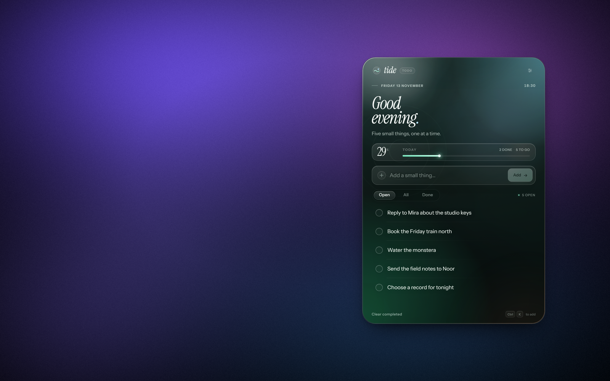
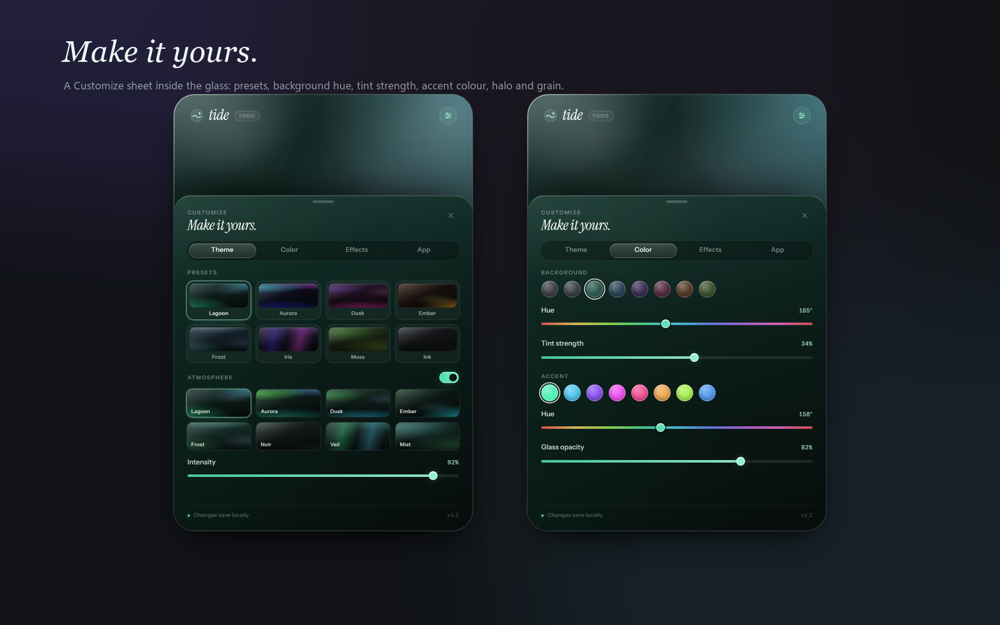
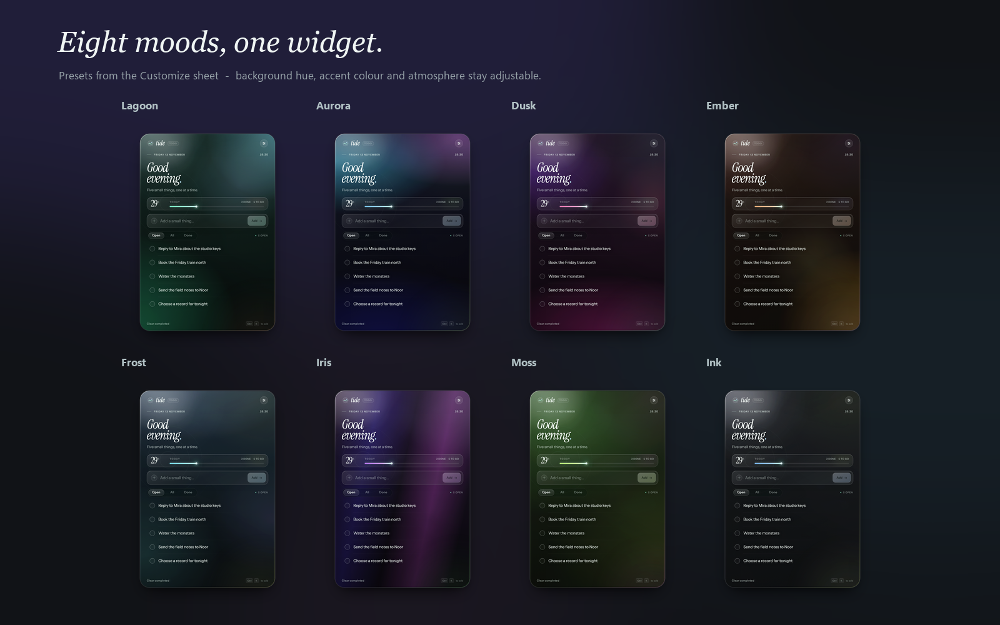

# Tide

[](https://github.com/Enkrid-Rao/LiquidGlassTodo/releases)
[](https://github.com/Enkrid-Rao/LiquidGlassTodo/releases)
[](https://github.com/Enkrid-Rao/LiquidGlassTodo/actions/workflows/ci.yml)
[](LICENSE)
[](#install)
[](https://www.electronjs.org/)

**A compact liquid-glass to-do widget that lives on your Windows desktop.**

Tide puts two ideas together: the permanent, glanceable presence of a Windows
desktop widget, and the direct manipulation of an iOS Control Center tile. The
card itself is the glass. The sliders icon in the corner opens a Customize
sheet that rises from inside the card, so the glass above it re-tints live
while you drag. Close the sheet and your list is exactly where you left it.

**English** · [中文](README_zh.md)

<p align="center">
  
</p>

## Highlights

- **A real desktop widget.** Frameless, transparent, always on top by default,
  remembers its corner of the screen, and can start with Windows.
- **One glass, many moods.** Eight one-click presets, eight atmosphere recipes,
  plus independent background hue, tint strength, accent hue and glass opacity.
- **Customize in place.** A four-tab sheet inside the card: Theme, Color,
  Effects and App. Every change previews instantly and saves locally.
- **Small, but not a toy.** Add, complete, edit, delete with undo, filter by
  Open / All / Done, clear completed with undo, and keyboard-first shortcuts.
- **Quiet by design.** No network calls, no telemetry, no account. Tasks and
  settings never leave the machine.
- **Cheap at idle.** No live `backdrop-filter` and no per-frame blur; the glass
  is built from baked textures and layered gradients, so GPU 3D stays at ~0%
  until you enable Ambient drift.

## Install

### Download (Windows 10 / 11, x64)

Grab the latest build from **[Releases](https://github.com/Enkrid-Rao/LiquidGlassTodo/releases)**:

| File | What it is |
| --- | --- |
| `Tide-<version>-win-x64.zip` | Portable folder build. Unzip anywhere and run `Tide.exe`. |
| `Tide-<version>-portable.exe` | Single-file portable executable. No install, no registry install step. |

The build is not code-signed, so Windows SmartScreen may show a "Windows
protected your PC" prompt on first launch. Choose **More info → Run anyway**.

### From source

Requires [Node.js](https://nodejs.org/) 20 or newer.

```powershell
git clone https://github.com/Enkrid-Rao/LiquidGlassTodo.git
cd LiquidGlassTodo
npm install
npm start
```

`npm start` launches Electron directly from the checkout. No build step is
needed while developing.

### Build the artifacts

```powershell
npm run dist
```

`electron-builder` writes the portable `.zip` and `.exe` into `dist/`.
Pushing a `v*` tag runs the same build on GitHub Actions and attaches the
artifacts to the release (see [`.github/workflows/release.yml`](.github/workflows/release.yml)).

## Using Tide

- **Add** — type and press `Enter`, or click **Add**.
- **Complete** — click the circle in front of a task.
- **Filter** — `Open` / `All` / `Done`. The default view is **Open**.
- **Edit** — double-click the task text, or hover and use the pencil.
- **Delete / undo** — hover and use the trash button, then hit **Undo** in the
  toast to restore it.
- **Clear completed** — the button at the bottom, also undoable.
- **Window** — drag the top bar; pin, minimize and close from the top-right.
- **First run** — seven sample tasks (five open, two done) so the widget is not
  empty. Edit or delete them freely.

Keyboard shortcuts:

| Shortcut | Action |
| --- | --- |
| `Ctrl` / `Cmd` + `K`, or `Ctrl` / `Cmd` + `N` | Focus the add field |
| `Enter` | Add the task |
| `Esc` | Close the sheet, clear the field, or leave the field |
| `←` / `→` | Switch Open / All / Done from anywhere outside a text field |

## The Customize sheet

Open it with the sliders icon in the top-right. It rises from the bottom of the
card and leaves the upper half as glass, so background, atmosphere and halo
changes are visible while you tune them. `Esc`, a click outside, or the `×`
closes it. Everything saves immediately.

| Tab | Controls |
| --- | --- |
| **Theme** | Eight presets; Atmosphere on/off; eight atmosphere recipes; intensity |
| **Color** | Eight background beads + hue + tint strength; eight accent beads + hue; glass opacity |
| **Effects** | Halo + strength; cursor light; grain; ambient drift (GPU); date line; 24-hour clock |
| **App** | Keep on top; start with Windows; reset window position; shortcut list; reset appearance |

<p align="center">
  
</p>

## Theme presets

Each preset sets background hue, tint strength, accent hue, atmosphere recipe
and intensity in one click. Move any slider afterwards and the preset stops
being highlighted — that is the app telling you it is a custom colour now.

| Preset | Background hue | Tint | Atmosphere | Intensity | Accent hue |
| --- | --- | --- | --- | --- | --- |
| Lagoon | 165° teal | 34% | Lagoon | 92% | 158° |
| Aurora | 236° blue-violet | 30% | Aurora | 95% | 202° |
| Dusk | 296° magenta | 27% | Dusk | 90% | 330° |
| Ember | 24° warm orange | 34% | Ember | 88% | 26° |
| Frost | 202° ice blue | 24% | Frost | 84% | 190° |
| Iris | 264° violet | 32% | Veil | 92% | 272° |
| Moss | 96° moss green | 30% | Mist | 86% | 88° |
| Ink | 218° neutral | 4% | Noir | 62% | 210° |

**Ink** is the answer to "I just want a clean dark glass": 4% tint and the
low-saturation Noir atmosphere, which leaves the card almost black-grey.

<p align="center">
  
</p>

## Settings

| Setting | What it does | Default |
| --- | --- | --- |
| Theme | One-click colour preset | Lagoon |
| Atmosphere | The light-field layer inside the card; off leaves plain tinted glass | On |
| Atmosphere style | Lagoon / Aurora / Dusk / Ember / Frost / Noir / Veil / Mist | Lagoon |
| Atmosphere intensity | Visibility of the atmosphere, 0–100% | 92% |
| Background | Glass tint: eight beads + hue + tint strength | 165° / 34% |
| Accent | Colour of buttons, progress, checks and sliders | 158° |
| Glass opacity | Opacity of the glass base, 30–100% | 82% |
| Halo | The top-left ceiling light on the glass | On |
| Halo strength | Halo intensity, 0–100% | 70% |
| Cursor light | Specular highlight that follows the pointer | On |
| Grain | Desaturated light-field texture inside the glass | On |
| Ambient drift | Slow motion inside the atmosphere; keeps using the GPU | Off |
| Date line | Date and time above the greeting | On |
| 24-hour clock | `21:14` instead of `9:14 PM` | On (24h) |
| Keep on top | Float above other windows; mirrors the pin button | On |
| Start with Windows | Register / remove the Windows login item | On |
| Reset window position | Move back to the lower-right corner | — |
| Reset appearance | Restore every appearance setting above (tasks and window untouched) | — |

> Glass opacity only affects the background glass layer; text and buttons stay
> fully readable even at lower values.
>
> Atmosphere off, tint at 0 and halo off gives a neutral dark glass. Halo,
> cursor light and grain are independent of the atmosphere switches.

## How the glass works

- **One variable-driven theme.** `--hue`, `--tint-s`, `--accent-h`,
  `--glass-alpha`, `--atmo-k`, `--halo-k` and `--grain-k` are the only numbers
  the theme engine writes. The glass tint, atmosphere, halo, button gradients,
  progress bar, checkboxes, switches, sliders and focus rings all derive from
  them — switching themes changes variables, not skin files.
- **Atmospheres are recipes, not pictures.** Each recipe is a set of
  hue-shifted `radial-gradient`s describing a lighting geometry, layered with a
  desaturated light-field texture (`assets/atmosphere-grain.jpg`, `overlay`
  blend) for detail. Any hue can wear the same "water light" look.
- **No live blur.** The refraction look comes from pre-baked textures, layered
  gradients, inner shadows and specular highlights, so the desktop is never
  blurred per frame and the GPU stays idle at rest. The Customize sheet does not
  use `backdrop-filter` either, which avoids renderer and GPU differences.
- **Local fonts.** Instrument Serif Italic for the display type, Instrument Sans
  for the interface. Both are bundled, so the app works offline.
- **Native window, web UI.** Electron with `frame: false`, `transparent: true`,
  a fixed 520×740 card, single-instance lock, position persistence and
  `app.setLoginItemSettings` for the startup entry. The interface is rendered
  with HTML/CSS/JS inside that window — not a browser page wrapped in Electron.

## Why a desktop app, not a Rainmeter skin

| | Electron app (this project) | Rainmeter skin |
| --- | --- | --- |
| Visual ceiling | HTML / CSS / SVG: layered glass, specular highlights, fine typography, custom motion | Meter layers are limited; complex refraction and highlights need many bitmaps and plugins |
| Interaction | Full text input, keyboard, filters, undo, inline editing | Complex input and list interaction is costly |
| Desktop integration | Frameless window, always on top, minimize/close, position memory, login item | Depends on the Rainmeter runtime; system window features are restricted |
| Delivery | Double-click to run, with local data and settings | Requires installing and configuring Rainmeter |
| Performance tuning | Precise control over layers, animation and GPU switches | Limited by the plugin and skin model |

The priority here was "a finished widget's interaction and desktop presence",
which is why the project is a desktop app: a native Electron window with a web
UI inside it.

## Project layout

```
LiquidGlassTodo/
├─ main.js                  # Main process: window, settings, login item, IPC
├─ preload.js               # Narrow IPC bridge for the renderer
├─ src/
│  ├─ index.html            # Structure, icons, Customize sheet
│  ├─ styles.css            # Theme tokens, glass layers, atmosphere recipes
│  └─ app.js                # Tasks, filters, storage, theme engine, shortcuts
├─ assets/
│  ├─ atmosphere-grain.jpg  # Desaturated light-field texture (runtime)
│  ├─ atmosphere.jpg        # Original texture, kept for reference
│  ├─ icon.svg/png/ico      # App icon
│  └─ fonts/                # Bundled fonts + OFL licences
├─ preview*.png             # README screenshots
└─ package.json             # Metadata, scripts and electron-builder config
```

## Data & privacy

- **Tasks** live in `localStorage` inside the Chromium profile under
  `%APPDATA%\Tide`.
- **Theme, window position, login item and pinning** live in
  `%APPDATA%\Tide\settings.json`.
- **Nothing is uploaded.** There is no network code, no analytics and no
  account. Uninstalling means deleting the app folder and `%APPDATA%\Tide`.
- **Migration is automatic.** Older settings files keep their existing values;
  new fields get defaults, so no manual editing is required.

## Development

```powershell
npm start        # run from the checkout
npm run check    # syntax-check main.js, preload.js and src/app.js
npm run pack     # unpacked build in dist/win-unpacked (for inspection)
npm run dist     # portable zip + portable exe
```

The release workflow in [`.github/workflows/release.yml`](.github/workflows/release.yml)
builds both artifacts on a `v*` tag and attaches them to the GitHub release.
The small CI workflow in [`.github/workflows/ci.yml`](.github/workflows/ci.yml)
runs the syntax check on every push to `main`.

See [CHANGELOG.md](CHANGELOG.md) for the version history.

## Relationship to Sill

Tide is a compact companion to **[Sill](https://github.com/Enkrid-Rao/sill)**,
a glass side rail for the Windows desktop. The theme engine proven here —
presets, atmospheric recipes, hue/tint separation — has been folded into Sill's
host-level appearance panel. Tide remains the small, single-purpose widget (and
a convenient testbed for new glass materials and motion).

## License

[MIT](LICENSE) © 2026 Xinxing Rao.

Bundled fonts are licensed under the SIL Open Font License 1.1; see
`assets/fonts/OFL-*.txt`. Electron and its dependencies keep their own licences.
