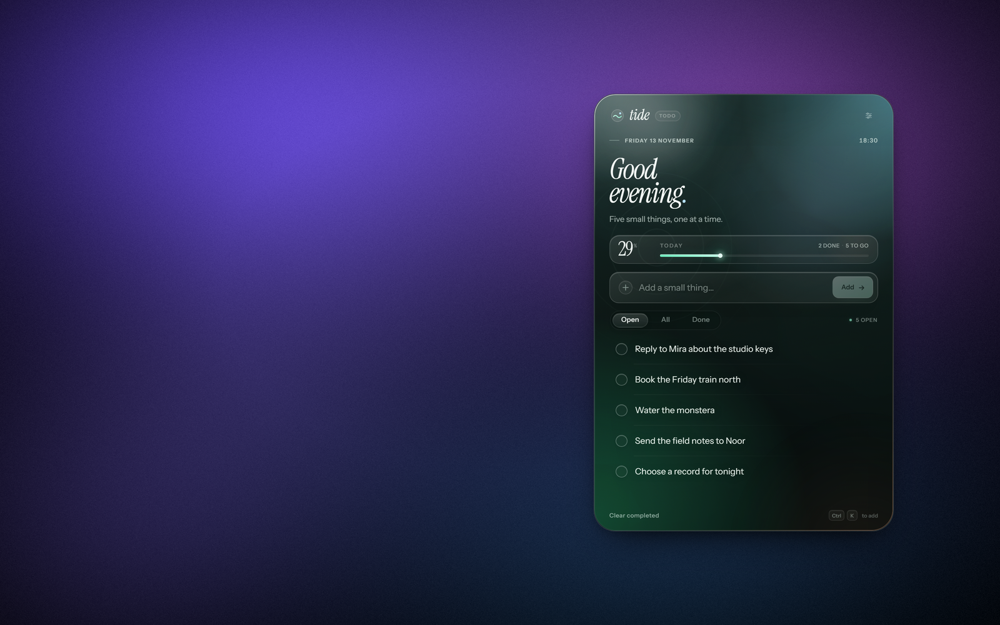
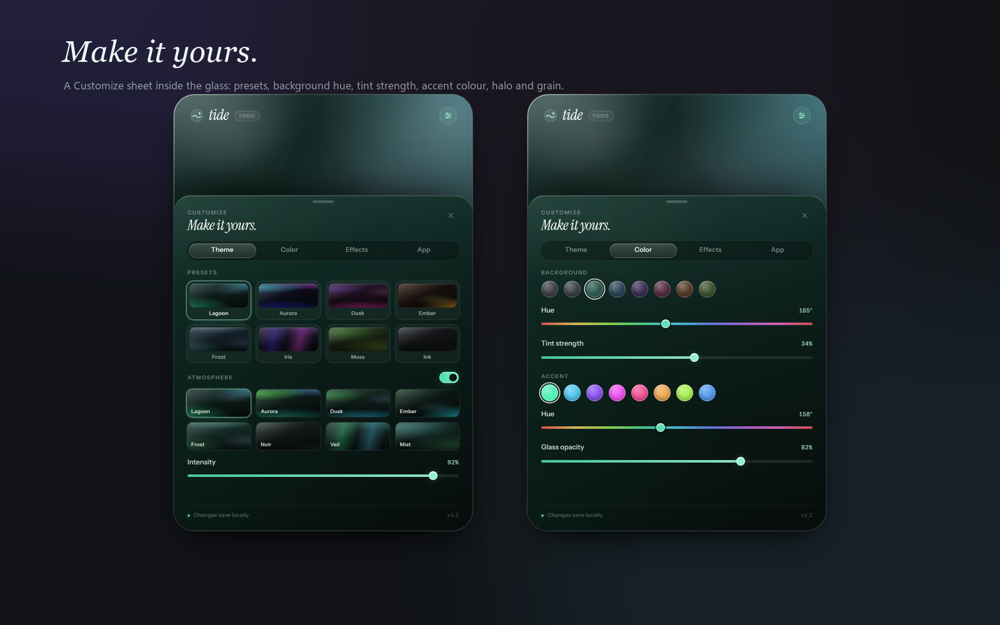
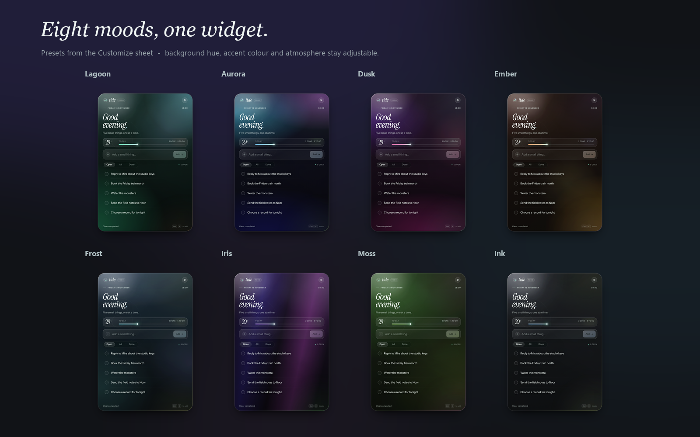

# Tide

[](https://github.com/Enkrid-Rao/LiquidGlassTodo/releases)
[](https://github.com/Enkrid-Rao/LiquidGlassTodo/releases)
[](https://github.com/Enkrid-Rao/LiquidGlassTodo/actions/workflows/ci.yml)
[](LICENSE)
[](#安装)
[](https://www.electronjs.org/)

**一个常驻桌面、以「液态玻璃」为视觉语言的紧凑 TODO 小组件。**

Tide 把两件事揉在一起：**Windows 小组件的「常驻桌面」**，和 **iOS 控制中心的「一块玻璃上直接操作」**。卡片本身就是那块玻璃；右上角滑杆图标打开一张从卡片内部升起来的 Customize 面板，改配色时上面那块玻璃实时在变，改完就关，不打断任务列表。

**中文** · [English](README.md)

<p align="center">
  
</p>

## 特色

- **真正的桌面小组件。** 无边框、透明、默认置顶、记住窗口位置，可以随 Windows 登录启动。
- **一块玻璃，多种情绪。** 8 套一键主题、8 种氛围配方，背景色相、上色强度、强调色和玻璃透明度都能单独调。
- **在卡片里改完。** 面板有 Theme / Color / Effects / App 四个 Tab，所有改动即时预览、即时保存。
- **小巧但不将就。** 添加、完成、编辑、删除（可撤销）、Open / All / Done 筛选、清理已完成（可撤销），全部支持键盘操作。
- **安静。** 不联网、不上报、不需要账号；任务和设置只留在这台电脑。
- **待机几乎不耗 GPU。** 不做实时 `backdrop-filter`，不逐帧模糊桌面；玻璃效果来自预烘焙纹理与多层渐变，只有手动打开 Ambient drift 才会持续使用 GPU。

## 安装

### 下载（Windows 10 / 11，x64）

到 **[Releases](https://github.com/Enkrid-Rao/LiquidGlassTodo/releases)** 下载最新的包：

| 文件 | 说明 |
| --- | --- |
| `Tide-<version>-win-x64.zip` | 免安装文件夹版，解压后双击 `Tide.exe`。 |
| `Tide-<version>-portable.exe` | 单文件便携版，不需要安装。 |

构建没有代码签名，首次运行时 Windows SmartScreen 可能提示「Windows 已保护你的电脑」，点 **更多信息 → 仍要运行** 即可。

### 从源码运行

需要 [Node.js](https://nodejs.org/) 20 或更高版本。

```powershell
git clone https://github.com/Enkrid-Rao/LiquidGlassTodo.git
cd LiquidGlassTodo
npm install
npm start
```

开发时不需要构建步骤，`npm start` 直接从项目目录启动 Electron。

### 打包

```powershell
npm run dist
```

`electron-builder` 会把便携版 `.zip` 和 `.exe` 输出到 `dist/`。推送 `v*` tag 时，GitHub Actions 会用同样的流程构建并挂到 Release 上（见 [`.github/workflows/release.yml`](.github/workflows/release.yml)）。

## 使用

- **添加**：输入后按 `Enter`，或点 **Add**。
- **完成任务**：点任务前的圆圈。
- **筛选**：`Open` / `All` / `Done`，默认 **Open**。
- **编辑**：双击任务文字，或悬停后点铅笔。
- **删除 / 撤销**：悬停点垃圾桶，Toast 里点 **Undo** 恢复。
- **清理已完成**：底部 **Clear completed**，同样可以撤销。
- **窗口**：拖动顶部栏移动；右上角图钉、最小化、关闭。
- **首次启动**：放入 7 条示例任务（5 条未完成、2 条已完成），可以直接编辑或删除。

快捷键：

| 快捷键 | 作用 |
| --- | --- |
| `Ctrl` / `Cmd` + `K`，或 `Ctrl` / `Cmd` + `N` | 聚焦添加框 |
| `Enter` | 添加任务 |
| `Esc` | 关闭面板、清空输入框，或退出输入框 |
| `←` / `→` | 在非文本输入状态下切换 Open / All / Done |

## Customize 面板

点右上角滑杆图标打开。面板从卡片底部升起，上半张卡留成一块玻璃，背景色相、氛围、光晕的改动就在这一块上实时可见。`Esc`、点面板外或右上角 `×` 都能关闭；所有改动立刻写入本地设置。

| Tab | 内容 |
| --- | --- |
| **Theme** | 8 套预设、Atmosphere 开关与 8 种氛围、Atmosphere 强度 |
| **Color** | Background 8 个色珠、Hue、Tint strength；Accent 8 个色珠、Hue；Glass opacity |
| **Effects** | Halo 开关与强度、Cursor light、Grain、Ambient drift（GPU）、Date line、24 小时制 |
| **App** | Keep on top、Start with Windows、重置窗口位置、快捷键表、Reset appearance |

<p align="center">
  
</p>

## 主题预设

点一下会同时设置背景色相、上色强度、强调色、氛围配方和氛围强度，之后所有滑杆都可以继续微调（微调后预设不再高亮，表示当前是自定义配色）。

| 预设 | 背景色相 | 上色强度 | 氛围 | 强度 | 强调色 |
| --- | --- | --- | --- | --- | --- |
| Lagoon | 165° 青绿 | 34% | Lagoon | 92% | 158° |
| Aurora | 236° 蓝紫 | 30% | Aurora | 95% | 202° |
| Dusk | 296° 品红 | 27% | Dusk | 90% | 330° |
| Ember | 24° 暖橙 | 34% | Ember | 88% | 26° |
| Frost | 202° 冰蓝 | 24% | Frost | 84% | 190° |
| Iris | 264° 紫罗兰 | 32% | Veil | 92% | 272° |
| Moss | 96° 苔绿 | 30% | Mist | 86% | 88° |
| Ink | 218° 中性 | 4% | Noir | 62% | 210° |

**Ink** 是「我只想要一块干净的深色玻璃」的答案：上色强度 4%，氛围是低饱和的 Noir，整张卡接近黑灰。

<p align="center">
  
</p>

## 设置项说明

| 设置 | 作用 | 默认 |
| --- | --- | --- |
| Theme | 一键配色预设 | Lagoon |
| Atmosphere | 卡片内部的氛围/水光层；关闭后就是纯玻璃底色 | 开 |
| Atmosphere style | Lagoon / Aurora / Dusk / Ember / Frost / Noir / Veil / Mist | Lagoon |
| Atmosphere intensity | 氛围可见度 0–100% | 92% |
| Background | 玻璃底色，8 个色珠 + Hue + Tint strength | 165° / 34% |
| Accent | 按钮、进度、勾选、滑杆的强调色 | 158° |
| Glass opacity | 玻璃底与水光层的透明程度，30%–100% | 82% |
| Halo | 左上角那块顶光，可开关 | 开 |
| Halo strength | 顶光强度 0–100% | 70% |
| Cursor light | 跟随鼠标的镜面高光 | 开 |
| Grain | 玻璃里的去色水光纹理；关掉更干净、更像纯色玻璃 | 开 |
| Ambient drift | 让氛围缓慢移动；会持续使用 GPU | 关 |
| Date line | 顶部日期 + 时间行 | 开 |
| 24-hour clock | `21:14` 或 `9:14 PM` | 开（24h） |
| Keep on top | 置顶，和右上角图钉联动 | 开 |
| Start with Windows | 注册/移除 Windows 登录启动项 | 开 |
| Reset window position | 把窗口放回右下角 | — |
| Reset appearance | 恢复以上所有外观项（不影响任务和窗口） | — |

> Glass opacity 只影响背景玻璃层，不会把文字和按钮一起做透明度处理；即使滑到较低数值，主内容仍然保持清晰。

> Atmosphere 关闭、Tint strength 拉到 0、Halo 也关掉时，卡片就是一块中性的深色玻璃；Halo / Cursor light / Grain 与 Atmosphere 是互相独立的开关。

## 玻璃是怎么做的

- **一套变量驱动的主题**：`--hue`、`--tint-s`、`--accent-h`、`--glass-alpha`、`--atmo-k`、`--halo-k`、`--grain-k` 七个数字，玻璃底色、氛围、光晕、按钮渐变、进度条、勾选圈、开关、滑杆和焦点环都从它们推导出来；切换主题只是改这几个变量，没有换皮肤文件。
- **氛围是配方，不是图片**：每种氛围由一组带色相偏移的 `radial-gradient` 定义光照几何，再叠一张去色的水光纹理（`assets/atmosphere-grain.jpg`，`overlay` 混合）提供细节。所以任意色相都能得到同一套「水光感」，而不是 8 张固定配色的位图。
- **没有实时 `backdrop-filter`**：玻璃的折射感来自预先烘焙的纹理、多层渐层、内阴影与高光，不逐帧模糊桌面；Customize 面板也不做 backdrop blur，避免不同渲染器/显卡下的差异。待机时 GPU 3D 基本为 `0%`，需要动态水光时再手动开 **Ambient drift**（面板里带 `GPU` 标记）。
- **字体**：标题/品牌使用 Instrument Serif Italic，界面使用 Instrument Sans。字体已本地化，离线可用。
- **窗口**：Electron `frame:false`、`transparent:true`、固定 520×740 卡片、桌面右下角初始位置、位置持久化、单实例运行。
- **自启**：Electron `app.setLoginItemSettings`，登录启动项注册表名为 `com.tide.widget`；开发状态下通过 `electron.exe + 项目路径` 注册。

## 为什么选桌面应用，而不是雨滴组件

| | Electron 桌面应用（本项目） | Rainmeter 雨滴组件 |
| --- | --- | --- |
| 视觉上限 | HTML / CSS / SVG 可以做多层玻璃、镜面高光、细排版和自定义动效 | Meter 图层能力有限，复杂折射/高光需要大量贴图和插件 |
| 交互 | 完整输入框、键盘操作、筛选、撤销、内联编辑 | 复杂输入和列表交互实现成本高 |
| 桌面能力 | 无边框窗口、置顶、最小化、关闭、窗口位置记忆、开机自启 | 依赖 Rainmeter 运行时，系统级窗口能力受限制 |
| 交付形态 | 双击即可运行的桌面应用，带本地数据和设置 | 需要安装和配置 Rainmeter 皮肤 |
| 性能调优 | 可以精确控制渲染层、动画和 GPU 开关 | 受插件与皮肤机制限制 |

这里更看重「成品小组件的交互与桌面能力」，所以选了**桌面应用**。窗口是 Electron 的原生窗口，界面与玻璃效果由 Web 技术渲染；它不是在 Electron 里再套一层浏览器页面。

## 项目结构

```
LiquidGlassTodo/
├─ main.js                  # 主进程、窗口、设置、自启、窗口位置、IPC
├─ preload.js               # 窗口 / 设置 IPC 安全桥
├─ src/
│  ├─ index.html            # 结构、图标、Customize 面板
│  ├─ styles.css            # 主题变量、玻璃层、氛围配方、面板与控件
│  └─ app.js                # 任务、筛选、持久化、主题引擎、快捷键
├─ assets/
│  ├─ atmosphere-grain.jpg  # 去色水光纹理（运行时使用）
│  ├─ atmosphere.jpg        # 原始水光纹理（grain 的来源，保留备查）
│  ├─ icon.svg/png/ico      # 应用图标
│  └─ fonts/                # 本地字体 + OFL 许可
├─ preview*.png             # README 截图
└─ package.json             # 元数据、脚本与 electron-builder 配置
```

## 数据与隐私

- **任务**：`localStorage`（Chromium 用户数据目录，位于 `%APPDATA%\Tide`）。
- **主题、窗口位置、自启、置顶**：`%APPDATA%\Tide\settings.json`。
- **不上传任何东西**：没有网络代码、没有统计、没有账号。卸载就是删掉应用文件夹和 `%APPDATA%\Tide`。
- **旧设置自动迁移**：原有字段原样保留，新增字段用默认值补齐，不需要手动改文件。

## 开发

```powershell
npm start        # 直接从项目目录运行
npm run check    # 检查 main.js / preload.js / src/app.js 语法
npm run pack     # 生成未打包目录 dist/win-unpacked（方便检查）
npm run dist     # 生成便携 zip + 便携 exe
```

推 `v*` tag 时，[`.github/workflows/release.yml`](.github/workflows/release.yml) 会构建两个产物并挂到 Release；
[`.github/workflows/ci.yml`](.github/workflows/ci.yml) 在每次 push 到 `main` 时跑语法检查。

版本历史见 [CHANGELOG.md](CHANGELOG.md)。

## 与 Sill 的关系

Tide 是 **[Sill](https://github.com/Enkrid-Rao/sill)**（Windows 桌面的玻璃侧边廊）的紧凑搭档。Tide 上验证过的主题系统——预设、氛围配方、色相与上色强度的解耦——已经收编进 Sill 的 host 级外观面板；Tide 继续作为单用途小部件保留，也顺便当作新玻璃材质与动效的试验田。

## 许可

[MIT](LICENSE) © 2026 Xinxing Rao.

随附字体以 SIL Open Font License 1.1 授权，见 `assets/fonts/OFL-*.txt`；Electron 及其依赖遵循各自许可。
